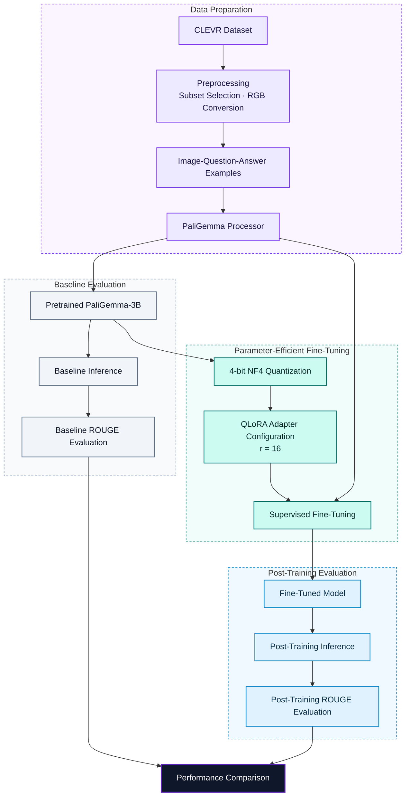
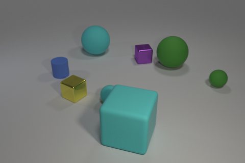
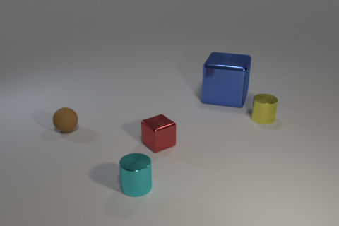

<div align="center">

</div>

---

# Parameter-Efficient Visual Question Answering with PaliGemma and QLoRA

This project investigates parameter-efficient fine-tuning of PaliGemma-3B for Visual Question Answering (VQA) using 4-bit quantization and Quantized Low-Rank Adaptation (QLoRA). Using the CLEVR dataset, the workflow covers multimodal data preparation, baseline inference, low-memory model adaptation, and post-training evaluation.

<div align="left">

[](https://www.python.org/)
[](https://pytorch.org/)
[](https://huggingface.co/docs/transformers/)
[](https://huggingface.co/google/paligemma-3b-pt-224)
[](https://huggingface.co/docs/peft/)
[](https://huggingface.co/docs/peft/developer_guides/quantization)
[](https://huggingface.co/datasets/HuggingFaceM4/clevr)
[](https://colab.research.google.com/)

</div>

## Abstract

Visual Question Answering combines computer vision and natural language understanding to answer questions about image contents. Although pretrained vision-language models offer strong multimodal capabilities, adapting them to a specific task can require substantial computational resources.

This project fine-tunes PaliGemma-3B using a parameter-efficient approach that combines 4-bit NF4 quantization with QLoRA. The workflow uses CLEVR image-question-answer examples for supervised adaptation, compares pretrained and fine-tuned predictions, and evaluates answer generation using ROUGE metrics.

The implementation demonstrates a practical workflow for multimodal model adaptation under constrained GPU-memory conditions without updating the full set of pretrained model weights.

## Table of Contents

1. [Overview](#overview)
2. [Methodology](#methodology)
   - [Model and Dataset](#model-and-dataset)
   - [Quantization and QLoRA](#quantization-and-qlora)
   - [Training Configuration](#training-configuration)
3. [System Architecture](#system-architecture)
4. [Experimental Results](#experimental-results)
5. [Project Structure](#project-structure)
6. [Installation and Execution](#installation-and-execution)
7. [References](#references)
8. [Author](#author)

## Overview

The project implements an end-to-end workflow for adapting a pretrained vision-language model to Visual Question Answering. Given an image and a natural-language question, the model generates an answer based on the visual input.

The main workflow includes:

- Loading a pretrained PaliGemma-3B checkpoint.
- Preparing image-question-answer examples from CLEVR.
- Evaluating the pretrained model to establish a baseline.
- Loading the model with 4-bit quantization.
- Applying LoRA adapters using Hugging Face PEFT.
- Fine-tuning with supervised question-answer examples.
- Comparing predictions before and after fine-tuning.

## Methodology

### Model and Dataset

The project uses the `leo009/paligemma-3b-pt-224` checkpoint. PaliGemma combines a SigLIP vision encoder with a Gemma language model to process image and text inputs and generate text outputs.

The experiments use [CLEVR](https://huggingface.co/datasets/HuggingFaceM4/clevr), a synthetic visual reasoning dataset containing images paired with natural-language questions and reference answers.

The preprocessing workflow loads the dataset, selects subsets for experimentation, converts images to RGB format, and formats image-question inputs using the PaliGemma processor. Reference answers are used as targets during supervised fine-tuning.

### Quantization and QLoRA

The notebook combines low-bit model loading with parameter-efficient adaptation.

| Component | Configuration |
|---|---|
| Model checkpoint | `leo009/paligemma-3b-pt-224` |
| Quantization | 4-bit NF4 |
| Compute dtype | FP16 |
| Double quantization | Disabled |
| LoRA rank | 16 |
| Learning rate | `2e-4` |
| Optimizer | Paged AdamW 8-bit |

The quantized base model reduces weight-storage requirements, while LoRA introduces trainable low-rank updates into selected attention and feed-forward projections. This avoids full-model fine-tuning and can substantially reduce training memory requirements.

### Training Configuration

The notebook uses Hugging Face Transformers' `Trainer` API with the following settings:

| Hyperparameter | Value |
|---|---|
| Training epochs | 2 |
| Training batch size per device | 4 |
| Evaluation batch size per device | 4 |
| Gradient accumulation steps | 5 |
| Evaluation interval | Every 100 steps |
| Checkpoint saving interval | Every 1,000 steps |
| Maximum retained checkpoints | 1 |
| Training precision flag | FP16 |

Actual memory consumption and runtime depend on GPU availability, input sequence lengths, software versions, and dataset configuration.

## System Architecture

The pipeline combines multimodal data preparation, baseline inference, quantized model loading, adapter-based fine-tuning, and quantitative evaluation.



## Experimental Results

### Quantitative Evaluation

The following scores are reported by the notebook for evaluation before and after fine-tuning.

| Metric | Before Fine-Tuning | After Fine-Tuning | Change |
|---|---:|---:|---:|
| ROUGE-1 | 0.3407 | 0.6909 | +0.3501 |
| ROUGE-2 | 0.0000 | 0.0000 | 0.0000 |
| ROUGE-L | 0.3402 | 0.6899 | +0.3496 |
| ROUGE-Lsum | 0.3398 | 0.6911 | +0.3514 |

The recorded results show higher ROUGE-1, ROUGE-L, and ROUGE-Lsum scores after fine-tuning. These metrics measure overlap between generated answers and reference answers; they do not independently establish visual reasoning accuracy.

ROUGE-2 remains zero in both evaluations and warrants further investigation into answer formatting, tokenization, and metric computation. Exact-match accuracy and task-specific answer correctness would complement these results.

### Qualitative Examples

The following examples illustrate model outputs on CLEVR images before and after fine-tuning. The images are included as qualitative references; they should be interpreted alongside the numerical evaluation rather than as standalone evidence of model performance.

**Example 1**

| Before Fine-Tuning | After Fine-Tuning |
|---|---|
|  |  |

**Example 2**

| Before Fine-Tuning | After Fine-Tuning |
|---|---|
|  |  |

## Project Structure

The repository contains the main notebook and selected visual examples used in the README. Reports and unrelated assignment files are intentionally excluded.

```text
Parameter-Efficient-Visual-Question-Answering-with-PaliGemma-and-QLoRA/
│
├── paligemma_vqa_qlora_finetuning.ipynb
├── README.md
└── assets/
    ├── clevr_sample_1.png
    ├── clevr_sample_1_finetuned.png
    ├── clevr_sample_5.png
    └── clevr_sample_5_finetuned.png
```

## Installation and Execution

### Google Colab

1. Upload the notebook to Google Colab.
2. Select a GPU runtime.
3. Run the notebook cells in order.
4. Install the required dependencies.
5. Authenticate with Hugging Face if access to the selected model checkpoint requires it.
6. Execute data preparation, baseline inference, fine-tuning, and evaluation.

### Local Environment

Clone the repository:

```bash
git clone https://github.com/farzadjannati/Parameter-Efficient-Visual-Question-Answering-with-PaliGemma-and-QLoRA.git

cd Parameter-Efficient-Visual-Question-Answering-with-PaliGemma-and-QLoRA
```

Create an environment and install the principal dependencies:

```bash
conda create -n paligemma-vqa python=3.10
conda activate paligemma-vqa

pip install torch transformers datasets accelerate
pip install peft bitsandbytes evaluate rouge-score
pip install tensorboard pillow matplotlib huggingface_hub jupyter
```

Launch the notebook:

```bash
jupyter notebook paligemma_vqa_qlora_finetuning.ipynb
```

For reproducibility, use compatible package versions and record the model checkpoint, dataset subsets, random seeds, GPU type, and training configuration. The notebook's own dependency versions should take precedence if they differ from the suggested installation commands.

## References

1. Beyer, L., et al. (2024). *PaliGemma: A versatile 3B VLM for transfer*. [arXiv:2407.07726](https://arxiv.org/abs/2407.07726).
2. Dettmers, T., Pagnoni, A., Holtzman, A., and Zettlemoyer, L. (2023). *QLoRA: Efficient Finetuning of Quantized LLMs*. [arXiv:2305.14314](https://arxiv.org/abs/2305.14314).
3. Hu, E. J., et al. (2022). *LoRA: Low-Rank Adaptation of Large Language Models*. [arXiv:2106.09685](https://arxiv.org/abs/2106.09685).
4. Johnson, J., Hariharan, B., van der Maaten, L., et al. (2017). *CLEVR: A Diagnostic Dataset for Compositional Language and Elementary Visual Reasoning*. CVPR.
5. Hugging Face. [Transformers Documentation](https://huggingface.co/docs/transformers/).
6. Hugging Face. [PEFT Documentation](https://huggingface.co/docs/peft/).

## Author

**Farzad Jannati**

M.Sc. Student, University of Tehran

Research Assistant, Social Networks Lab

**Research Interests:** Natural Language Processing, Large Language Models, Vision-Language Models, Multimodal Learning, and Parameter-Efficient Fine-Tuning.

<div align="left">

[](mailto:farzadjannati@ut.ac.ir)
[](https://github.com/farzadjannati)
[](https://www.linkedin.com/in/farzadjannati)

</div>

<p align="center">
  Built with PyTorch, Hugging Face Transformers, PaliGemma, and QLoRA.
</p>

---

# Parameter-Efficient Visual Question Answering with PaliGemma and QLoRA

This project investigates parameter-efficient fine-tuning of PaliGemma-3B for Visual Question Answering (VQA) using 4-bit quantization and Quantized Low-Rank Adaptation (QLoRA). Using the CLEVR dataset, the workflow covers multimodal data preparation, baseline inference, low-memory model adaptation, and post-training evaluation.

<div align="left">

[](https://www.python.org/)
[](https://pytorch.org/)
[](https://huggingface.co/docs/transformers/)
[](https://huggingface.co/google/paligemma-3b-pt-224)
[](https://huggingface.co/docs/peft/)
[](https://huggingface.co/docs/peft/developer_guides/quantization)
[](https://huggingface.co/datasets/HuggingFaceM4/clevr)
[](https://colab.research.google.com/)

</div>

## Abstract

Visual Question Answering combines computer vision and natural language understanding to answer questions about image contents. Although pretrained vision-language models offer strong multimodal capabilities, adapting them to a specific task can require substantial computational resources.

This project fine-tunes PaliGemma-3B using a parameter-efficient approach that combines 4-bit NF4 quantization with QLoRA. The workflow uses CLEVR image-question-answer examples for supervised adaptation, compares pretrained and fine-tuned predictions, and evaluates answer generation using ROUGE metrics.

The implementation demonstrates a practical workflow for multimodal model adaptation under constrained GPU-memory conditions without updating the full set of pretrained model weights.

## Table of Contents

1. [Overview](#overview)
2. [Methodology](#methodology)
   - [Model and Dataset](#model-and-dataset)
   - [Quantization and QLoRA](#quantization-and-qlora)
   - [Training Configuration](#training-configuration)
3. [System Architecture](#system-architecture)
4. [Experimental Results](#experimental-results)
5. [Project Structure](#project-structure)
6. [Installation and Execution](#installation-and-execution)
7. [References](#references)
8. [Author](#author)

## Overview

The project implements an end-to-end workflow for adapting a pretrained vision-language model to Visual Question Answering. Given an image and a natural-language question, the model generates an answer based on the visual input.

The main workflow includes:

- Loading a pretrained PaliGemma-3B checkpoint.
- Preparing image-question-answer examples from CLEVR.
- Evaluating the pretrained model to establish a baseline.
- Loading the model with 4-bit quantization.
- Applying LoRA adapters using Hugging Face PEFT.
- Fine-tuning with supervised question-answer examples.
- Comparing predictions before and after fine-tuning.

## Methodology

### Model and Dataset

The project uses the `leo009/paligemma-3b-pt-224` checkpoint. PaliGemma combines a SigLIP vision encoder with a Gemma language model to process image and text inputs and generate text outputs.

The experiments use [CLEVR](https://huggingface.co/datasets/HuggingFaceM4/clevr), a synthetic visual reasoning dataset containing images paired with natural-language questions and reference answers.

The preprocessing workflow loads the dataset, selects subsets for experimentation, converts images to RGB format, and formats image-question inputs using the PaliGemma processor. Reference answers are used as targets during supervised fine-tuning.

### Quantization and QLoRA

The notebook combines low-bit model loading with parameter-efficient adaptation.

| Component | Configuration |
|---|---|
| Model checkpoint | `leo009/paligemma-3b-pt-224` |
| Quantization | 4-bit NF4 |
| Compute dtype | FP16 |
| Double quantization | Disabled |
| LoRA rank | 16 |
| Learning rate | `2e-4` |
| Optimizer | Paged AdamW 8-bit |

The quantized base model reduces weight-storage requirements, while LoRA introduces trainable low-rank updates into selected attention and feed-forward projections. This avoids full-model fine-tuning and can substantially reduce training memory requirements.

### Training Configuration

The notebook uses Hugging Face Transformers' `Trainer` API with the following settings:

| Hyperparameter | Value |
|---|---|
| Training epochs | 2 |
| Training batch size per device | 4 |
| Evaluation batch size per device | 4 |
| Gradient accumulation steps | 5 |
| Evaluation interval | Every 100 steps |
| Checkpoint saving interval | Every 1,000 steps |
| Maximum retained checkpoints | 1 |
| Training precision flag | FP16 |

Actual memory consumption and runtime depend on GPU availability, input sequence lengths, software versions, and dataset configuration.

## System Architecture

The pipeline combines multimodal data preparation, baseline inference, quantized model loading, adapter-based fine-tuning, and quantitative evaluation.


## Experimental Results

### Quantitative Evaluation

The following scores are reported by the notebook for evaluation before and after fine-tuning.

| Metric | Before Fine-Tuning | After Fine-Tuning | Change |
|---|---:|---:|---:|
| ROUGE-1 | 0.3407 | 0.6909 | +0.3501 |
| ROUGE-2 | 0.0000 | 0.0000 | 0.0000 |
| ROUGE-L | 0.3402 | 0.6899 | +0.3496 |
| ROUGE-Lsum | 0.3398 | 0.6911 | +0.3514 |

The recorded results show higher ROUGE-1, ROUGE-L, and ROUGE-Lsum scores after fine-tuning. These metrics measure overlap between generated answers and reference answers; they do not independently establish visual reasoning accuracy.

ROUGE-2 remains zero in both evaluations and warrants further investigation into answer formatting, tokenization, and metric computation. Exact-match accuracy and task-specific answer correctness would complement these results.

### Qualitative Examples

The following examples illustrate model outputs on CLEVR images before and after fine-tuning. The images are included as qualitative references; they should be interpreted alongside the numerical evaluation rather than as standalone evidence of model performance.

**Example 1**

| Before Fine-Tuning | After Fine-Tuning |
|---|---|
|  |  |

**Example 2**

| Before Fine-Tuning | After Fine-Tuning |
|---|---|
|  |  |

## Project Structure

The repository contains the main notebook and selected visual examples used in the README. Reports and unrelated assignment files are intentionally excluded.

```text
Parameter-Efficient-Visual-Question-Answering-with-PaliGemma-and-QLoRA/
│
├── paligemma_vqa_qlora_finetuning.ipynb
├── README.md
└── assets/
    ├── clevr_sample_1.png
    ├── clevr_sample_1_finetuned.png
    ├── clevr_sample_5.png
    └── clevr_sample_5_finetuned.png
```

## Installation and Execution

### Google Colab

1. Upload the notebook to Google Colab.
2. Select a GPU runtime.
3. Run the notebook cells in order.
4. Install the required dependencies.
5. Authenticate with Hugging Face if access to the selected model checkpoint requires it.
6. Execute data preparation, baseline inference, fine-tuning, and evaluation.

### Local Environment

Clone the repository:

```bash
git clone https://github.com/farzadjannati/Parameter-Efficient-Visual-Question-Answering-with-PaliGemma-and-QLoRA.git

cd Parameter-Efficient-Visual-Question-Answering-with-PaliGemma-and-QLoRA
```

Create an environment and install the principal dependencies:

```bash
conda create -n paligemma-vqa python=3.10
conda activate paligemma-vqa

pip install torch transformers datasets accelerate
pip install peft bitsandbytes evaluate rouge-score
pip install tensorboard pillow matplotlib huggingface_hub jupyter
```

Launch the notebook:

```bash
jupyter notebook paligemma_vqa_qlora_finetuning.ipynb
```

For reproducibility, use compatible package versions and record the model checkpoint, dataset subsets, random seeds, GPU type, and training configuration. The notebook's own dependency versions should take precedence if they differ from the suggested installation commands.

## References

1. Beyer, L., et al. (2024). *PaliGemma: A versatile 3B VLM for transfer*. [arXiv:2407.07726](https://arxiv.org/abs/2407.07726).
2. Dettmers, T., Pagnoni, A., Holtzman, A., and Zettlemoyer, L. (2023). *QLoRA: Efficient Finetuning of Quantized LLMs*. [arXiv:2305.14314](https://arxiv.org/abs/2305.14314).
3. Hu, E. J., et al. (2022). *LoRA: Low-Rank Adaptation of Large Language Models*. [arXiv:2106.09685](https://arxiv.org/abs/2106.09685).
4. Johnson, J., Hariharan, B., van der Maaten, L., et al. (2017). *CLEVR: A Diagnostic Dataset for Compositional Language and Elementary Visual Reasoning*. CVPR.
5. Hugging Face. [Transformers Documentation](https://huggingface.co/docs/transformers/).
6. Hugging Face. [PEFT Documentation](https://huggingface.co/docs/peft/).

## Author

**Farzad Jannati**

M.Sc. Student, University of Tehran

Research Assistant, Social Networks Lab

**Research Interests:** Natural Language Processing, Large Language Models, Vision-Language Models, Multimodal Learning, and Parameter-Efficient Fine-Tuning.

<div align="left">

[](mailto:farzadjannati@ut.ac.ir)
[](https://github.com/farzadjannati)
[](https://www.linkedin.com/in/farzadjannati)

</div>

<p align="center">
  Built with PyTorch, Hugging Face Transformers, PaliGemma, and QLoRA.
</p>
